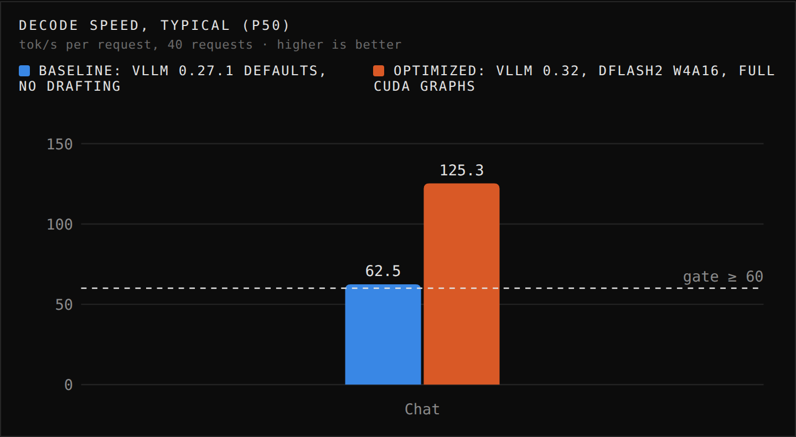
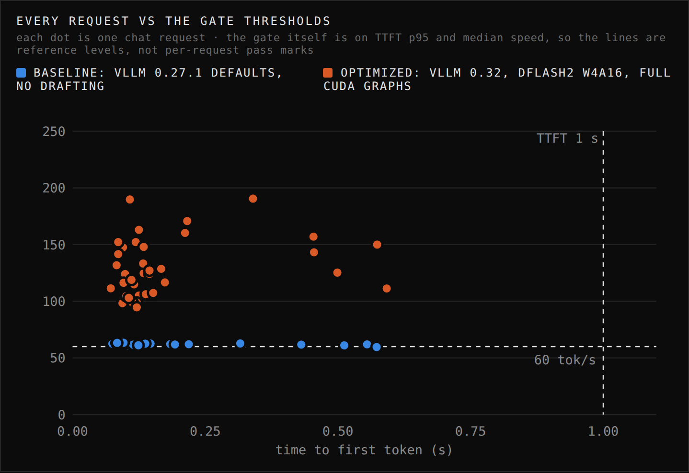
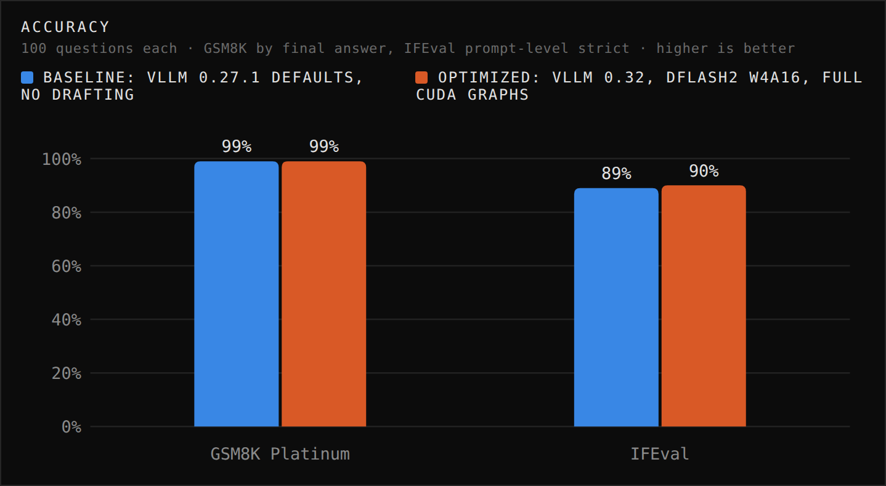
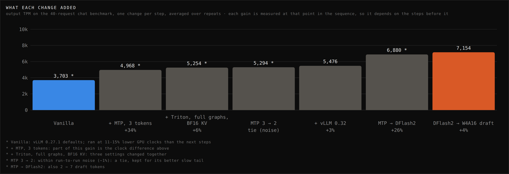

# Qwen3.8-27B at 125 tok/s per request on 2x RTX 3090

The goal was the highest output tokens per minute (TPM) from the smartest model this machine can run, with every request meeting a latency gate: **TTFT p95 under 1 s and decode speed p50 of at least 60 tok/s**. Answers also have to stay correct, so every claimed setup is checked against a fixed accuracy suite. Scope: one request at a time, chat prompts, thinking on.

## Best result

| Model | Engine | Speculation | tok/s p50 | tok/s p5 | TTFT p50 | TTFT p95 | TPM | Errors | Gate |
|---|---|---|---|---|---|---|---|---|---|
| Qwen3.8-27B INT4 | vLLM 0.32.0, TP=2 | DFlash2 W4A16 draft model, 7 tokens per block | **125.3** | 98.3-98.9 | 0.125-0.130 s | 0.574-0.575 s | **7,151-7,158** | 0 / 40 | PASS |

Two runs, 40 real chat requests each, agreeing within 0.1%. That's **2.0× the decode speed and +93% TPM** of the same model and engine untuned (62.5 tok/s, 3,703 TPM).

**Accuracy** on this exact config (fixed suite, first 100 questions each, one request at a time):

| Benchmark | This config | RedHat, same INT4 weights |
|---|---|---|
| GSM8K Platinum | **99%** | 96.77% |
| IFEval, prompt-level strict | **90%** | 91.93% |

GSM8K is scored by the final stated answer (`rescore.py`); lm-eval's last-number rule reports 92% because it misreads answers like "**160 minutes**, or 2 hours and 40 minutes". The one real miss is the same question in every config. IFEval: 5 of the 10 misses are empty answers, where thinking used the whole 32,768-token budget on a constraint-heavy prompt; 90 of the 95 answered prompts pass. With 100 questions, expect about ±3-4 points.

## Baseline vs optimized

The same model, the same 40 chat prompts and the same accuracy suite, run on vLLM's defaults (vLLM 0.27.1, TP=2, no drafting) and on the optimized config.

| | Baseline | Optimized | Change |
|---|---|---|---|
| Decode tok/s, p50 | 62.5 | **125.3** | 2.0× |
| Decode tok/s, p5 (slowest 5%) | 61.1 | **98.3-98.9** | +61% |
| TTFT p95 | 0.555 s | 0.574-0.575 s | +0.02 s (gate: 1 s) |
| Output TPM | 3,703 | **7,151-7,158** | +93% |
| Speed gate (p50 ≥ 60 tok/s, TTFT p95 < 1 s) | passes by 2.5 tok/s | passes by 65 tok/s | |
| GSM8K Platinum | 99% | **99%** | same |
| IFEval, prompt-level strict | 89% | **90%** | +1 pt |

Accuracy is unchanged: both differences are well inside the ±3-4 points that 100 questions allow. Speculative decoding verifies every drafted token against the main model, so it changes speed, not the model. Outputs can still differ slightly between configs, which is why each one gets its own run. The baseline's IFEval misses include 7 empty answers, where thinking used the whole 32,768-token budget (the optimized config had 5); on the 93 it answered, it scored 89.

**Race replay video:** [docs/race-replay.mp4](docs/race-replay.mp4), the two configs answering the same three prompts (chat, GSM8K, IFEval) side by side, rendered frame by frame at their recorded speed. They can't run at the same moment: each one uses both GPUs. Charts for every number on this page are in [docs/plots/](docs/plots/), and the interactive version is `race.html`, also served by `demo.py` at `/compare`.






## What each change did

Each row adds one change to the row above. Same 40-request chat benchmark throughout. Ranges are two runs of the same config.

| # | Change | TTFT p95 | tok/s p50 | tok/s p5 | TPM | TPM vs previous | Accuracy (GSM8K / IFEval) |
|---|---|---|---|---|---|---|---|
| 0 | **Vanilla:** Qwen3.8-27B INT4, vLLM 0.27.1, TP=2, vLLM's defaults, no drafting | 0.555 s | 62.5 | 61.1 | 3,703 | | 99% / 89% |
| 1 | + MTP drafting (the model's own head), 3 tokens | 0.599 s | 84.1 | 72.6 | 4,968 | +34% | |
| 2 | + Triton attention, full CUDA graphs, BF16 KV cache | 0.576-0.584 s | 89.6-89.7 | 76.4-77.1 | 5,229-5,278 | +5-6% | |
| 3 | MTP 3 → 2 draft tokens | 0.586 s | 89.2 | **82.0** | 5,294 | +1% (tie); better slow tail | 99% / 89% |
| 4 | vLLM 0.27.1 → 0.32.0 | 0.571-0.573 s | 92.2-92.4 | 85.1-85.2 | 5,470-5,483 | +3% | |
| 5 | MTP → DFlash2 draft model (BF16), 7 tokens per block | 0.579-0.580 s | 117.5-121.6 | 94.4-96.4 | 6,793-6,967 | +24-27% | 99% / 91% |
| 6 | **DFlash2 draft model BF16 → W4A16** | **0.574-0.575 s** | **125.3** | **98.3-98.9** | **7,151-7,158** | **+3-5%** | **99% / 90%** |

How to read it: each gain is measured on top of the steps before it, so it depends on order (full CUDA graphs, for example, help more once drafting is on). Step 2 changed three settings together. Step 3 is within run-to-run noise (~1%). The vanilla run happened to hold 11-15% lower GPU clocks than step 1, so part of step 1's +34% is clock. TTFT stayed between 0.55 and 0.60 s through every change (the gate is 1 s). The slow tail (p5) rose from 61 to 98 tok/s along with the median. Why each change helps is in [OPTIMIZATIONS.md](OPTIMIZATIONS.md). Every run, including those that lost or failed, is in [RUNS.md](RUNS.md).

## Hardware

| Part | Detail |
|---|---|
| GPUs | 2x RTX 3090 24 GB, each power-capped to **225 W** (stock 350 W); every run hit the cap |
| GPU link | No NVLink, no P2P (`nvidia-smi topo -p2p r`: CNS). Cross-GPU traffic goes through host memory |
| PCIe | GPU0 4.0 **x4**, GPU1 4.0 x8 |
| CPU / RAM | Ryzen 7 9800X3D (12 vCPUs visible), 48 GiB RAM + 8 GiB swap |
| Platform | Ubuntu 24.04.5 guest on QEMU/KVM, both GPUs passed through; kernel 6.17, driver 590.44.01, CUDA 13.1 toolkit at `/usr/local/cuda-13.1` (system `nvcc` is 12.0) |

## Engine and settings

vLLM 0.32.0 (PyTorch 2.13.0+cu130) in its own environment, `~/venvs/vllm032`. `./serve.sh` with no arguments builds exactly this launch:

```bash
CUDA_HOME=/usr/local/cuda-13.1 PATH=/usr/local/cuda-13.1/bin:$PATH \
CUDA_VISIBLE_DEVICES=0,1 VLLM_USE_FLASHINFER_SAMPLER=0 ~/venvs/vllm032/bin/vllm serve ~/models/qwen3.8-27b/int4 \
  --tensor-parallel-size 2 \
  --speculative-config "{\"method\":\"dflash\",\"model\":\"$HOME/models/qwen3.8-27b/dflash2-w4a16\",\"num_speculative_tokens\":7}" \
  --attention-backend TRITON_ATTN \
  --compilation-config '{"cudagraph_mode":"FULL_AND_PIECEWISE"}' \
  --kv-cache-dtype bfloat16 \
  --max-num-seqs 4 --max-num-batched-tokens 4096 --max-model-len 16384 --gpu-memory-utilization 0.86 \
  --default-chat-template-kwargs '{"enable_thinking": true}' --reasoning-parser qwen3 \
  --language-model-only --enable-prompt-tokens-details --served-model-name llm
```

| Setting | Value | Why |
|---|---|---|
| Weights | `RedHatAI/Qwen3.8-27B-INT4` (W4A16: 4-bit weights, 16-bit math, Marlin kernels) | ~19 GB; RedHat measures 98.5-101% of BF16 accuracy |
| Parallelism | Tensor parallel across both cards | One request gets both cards' memory bandwidth and power budget |
| Speculation | `syvai/Qwen3.8-27B-DFlash2-W4A16` (revision `4d30ec7`), a 5-layer, 1.28 GB draft model; 7 tokens per block | Drafts a whole block in one pass, and the main model verifies all of it. The 4-bit version reads a third as much per step as the BF16 original |
| vLLM version | 0.32.0 | DFlash2 support (merged Aug 2026); also +3% for the same MTP config |
| Attention / CUDA graphs / KV cache | Triton, full + piecewise graphs, BF16 | vLLM's default (FlashInfer) can't capture full graphs while drafting; Triton can. Triton can't read an FP8 KV cache on a 3090, so BF16 |
| `CUDA_HOME` = CUDA 13.1 | for FlashInfer's JIT compiler | DFlash2's top-k kernel compiles on first start and fails with the system nvcc 12.0 |
| `VLLM_USE_FLASHINFER_SAMPLER=0` | torch sampler | Turning the FlashInfer sampler on (`FI_SAMPLER=1`) measured within noise |

Resolved by vLLM itself (from the run's log): Marlin INT4 kernels, Triton attention for the main model and FlashAttention 2 for the draft model, full CUDA graphs captured, chunked prefill on, prefix caching off, PyNCCL all-reduce (custom all-reduce off: no P2P).

Metrics count every generated token, thinking included: TPM, decode tok/s and TTFT (time to the first streamed reasoning or answer token). That's the standard way to measure generation throughput; time to the first *answer* token is longer, because the model reasons first.

## Method

- **Speed:** `bench.py` sends the first 40 prompts of `data/chat.jsonl` (English WildChat first turns, median 104 prompt tokens) one at a time, after 2 warmups. Temperature 0, up to 1,024 output tokens, natural stop, thinking on. TTFT is measured on the client. Decode tok/s per request = (output tokens - 1) / time after the first token. TPM = total output tokens / wall time x 60. GPU clocks, power, temperature and throttle flags are logged every second.
- **Gate:** all requests succeed, TTFT p95 < 1.0 s, decode tok/s p50 >= 60. p5 is the slow tail for speed (95% of requests were faster), p95 the slow tail for TTFT.
- **Accuracy:** `suite.sh` runs `eval.sh` (lm-eval 0.4.13) then `rescore.py`: GSM8K Platinum zero-shot CoT, scored by final answer, and IFEval prompt-level strict, the first 100 questions of each. 32,768-token budget including thinking, one request at a time. These are the benchmarks RedHat reports for this checkpoint.

## Reproduce

```bash
uv run prep.py                        # data/chat.jsonl (1,000 WildChat prompts; the bench uses the first 40)
./sweep.sh my-run                     # start the best config, bench it, stop it; row lands in results/summary.jsonl
./suite.sh my-run                     # accuracy suite on the same config -> results/eval/my-run/
SPEC=mtp ./sweep.sh my-mtp-run        # the MTP-head alternative
python3 report.py                     # results table for every label
```

Needs `~/venvs/vllm032` (`uv venv ~/venvs/vllm032 --python 3.12 && uv pip install --python ~/venvs/vllm032/bin/python vllm==0.32.0`), the main model in `~/models/qwen3.8-27b/int4` (`RedHatAI/Qwen3.8-27B-INT4`) and the draft model in `~/models/qwen3.8-27b/dflash2-w4a16` (`syvai/Qwen3.8-27B-DFlash2-W4A16` at revision `4d30ec7`).

**Live demo:** `uv run prep.py --demo` builds `data/demo.jsonl`, 20 prompts spread evenly over the three benchmarks used (7 chat, 7 GSM8K Platinum, 6 IFEval, interleaved). Start `./serve.sh`, then `uv run demo.py data/demo.jsonl --label demo -n 20 --max-tokens 1024`, open http://localhost:8090 and press **Run**. Each press records a new run (`demo-1`, `demo-2`, …) while the page streams the thinking, the answer and the gate metrics. With 20 requests, p5 is the second-slowest request: exactly one is slower. Math and instruction prompts draft more easily than chat (GSM8K prompts decode at ~188 tok/s), so the demo's median runs above the chat-only table, while its slowest requests and TPM run below it. It isn't directly comparable. Overhead measured on the 7 chat prompts both sets share (identical outputs): the page's streaming costs about 3%, and screen-recording with OBS (1080p60, NVENC on the display GPU) about 8% more, 11% in total. `docker compose -f grafana/docker-compose.yaml up -d` gives a Grafana dashboard of vLLM's own metrics at http://localhost:3001. Its TPM panel averages over a minute, so it reads low for the first ~60 s of a run.

| File | Purpose |
|---|---|
| `serve.sh`, `sweep.sh` | Start vLLM with every setting as an env var; run one benchmarked config |
| `bench.py`, `report.py` | Benchmark client and results table |
| `suite.sh`, `eval.sh`, `tasks/`, `rescore.py` | Fixed accuracy suite and final-answer GSM8K scoring |
| `levers.sh`, `dflash.sh`, `exl3.sh`, `tabby.sh`, `strata.sh` | The sweeps, engines and drafters tried (see RUNS.md) |
| `demo.py`, `demo.html`, `grafana/` | Live demo page and dashboard |
| `race.py`, `race.template.html`, `race_capture.sh` | Capture both configs on the same prompts, build the comparison page `race.html` |
| `render_race.py`, `export_plots.py`, `export_summary.py`, `finalize.sh` | Render the race to `docs/race-replay.mp4`, export each chart to `docs/plots/` and the gate metrics plus accuracy on one image, `docs/summary.png` |
| `results/summary.jsonl` | One line per benchmark run, the source of every number here |

## Next steps

- **Concurrency.** Everything here is one request at a time, by design. Decode is memory-bound, so 2-4 concurrent streams should multiply total TPM while each stream stays above 60 tok/s. This is the largest gain left.
- **Locked GPU clocks** (`nvidia-smi -lgc`) for every run. The ladder would then need no clock caveat.
- **A profile of one decode step** (Nsight Systems). It would show what share of each token goes to the PCIe all-reduce without P2P, and whether one GPU plus the draft model beats TP=2 for a 19 GB model.
- **A draft model tuned on chat data.** More drafted tokens kept per step is where the next 10-20% would come from.
